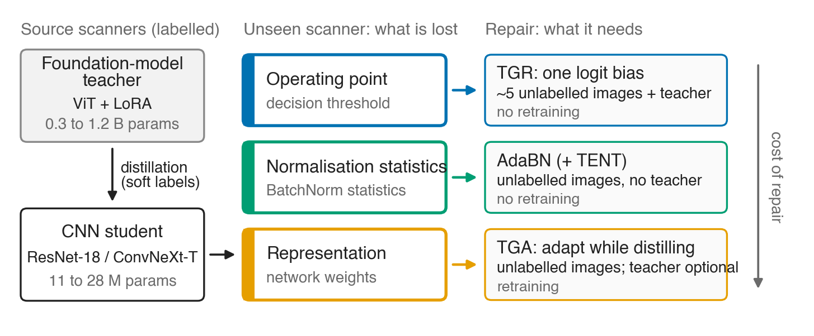
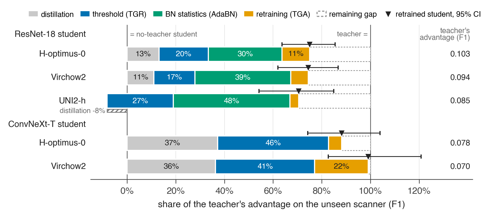
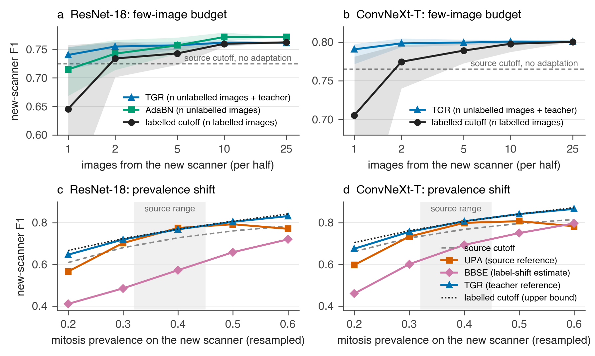

# Recovering Scanner Robustness Lost in Distillation

**A case study of pathology foundation models for mitotic figure classification**

Shenghan Gao, SeongJun Kwon, Axel Ramirez · Washington University in St. Louis

[Paper (PDF)](paper/manuscript/main.pdf) · [Figures](figures/paper/) · [Pre-registration protocols](protocols/) ·
[Team code](https://github.com/ksj1999/General_Mitosis_Detection)

> **TL;DR.** When a billion-parameter pathology foundation model is distilled into a small CNN, the student keeps the
> teacher's *ranking* of cells but not its *decision threshold* on a new scanner. Most of the lost robustness sits in the
> operating point and the BatchNorm statistics, and a few unlabelled images from the new scanner, plus one forward pass
> of the teacher, bring most of it back. The repaired ConvNeXt-T student is 23–41× smaller and 62–98× faster than its
> teacher and recovers 86–99% of the teacher's advantage.



## Why this matters

Foundation models such as H-optimus-0, Virchow2 and UNI are among the most robust classifiers of mitotic figures on
scanners they have never seen, but they classify only 80–342 cells per second, while a whole slide holds thousands of
candidates. In practice they are therefore distilled into small task models that run at one fixed threshold.
Distilled pathology encoders have been reported to be as robust as their teachers, but those evaluations used
embedding similarity or AUC, which cannot see a threshold that has drifted. This project measures robustness where
it matters for deployment, F1 at a fixed operating point on an unseen scanner, and asks:

1. Does distillation carry the teacher's scanner robustness to the student?
2. If not, where is it lost?
3. What does each part of the loss need to be repaired, and what is the teacher actually needed for?
4. How close can a small, repaired student get to its teacher, and at what cost?

## Approach

**Setting.** Mitotic figure vs. imposter classification on the human breast subset of
[MIDOG++](https://doi.org/10.1038/s41597-023-02327-4): 150 cases from three scanners (Hamamatsu XR, Hamamatsu S360,
Aperio CS2), 4,435 cells. One scanner is held out at a time. Four LoRA-adapted foundation models are distilled into
ResNet-18 (BatchNorm) and ConvNeXt-T (LayerNorm) students.

**Three layers, repaired in order of cost.**

| Layer | What goes wrong on a new scanner | Repair | What it needs |
|---|---|---|---|
| Operating point | the cutoff chosen on source scanners is wrong, even though the ranking (AUROC) is kept | **TGR**: fit one logit offset so the student agrees with the teacher on unlabelled target cells | a few unlabelled images and the teacher's forward pass |
| Normalisation statistics | BatchNorm statistics are those of the source scanners | **AdaBN** (and TENT) | unlabelled images |
| Representation | the features themselves | **TGA**: retrain with the unlabelled target cells added to distillation | retraining |

**Controls and statistics.**
- **Controls without any foundation model** separate the teacher's contribution from that of the unlabelled target
  images.
- **Pre-registration:** every confirmatory contrast was written down, with its expected direction and a file hash,
  before the corresponding models were trained ([`protocols/`](protocols/)).
- **Uncertainty and corrections:** a paired bootstrap over images and seeds, with Holm correction within each family.
- **No leakage:** all target images are used for evaluation through cross-fitting, so a cell is never scored by a
  model that saw its image.

## Results

New-scanner F1 (mean over 10 seeds and 3 held-out scanners), H-optimus-0 teacher:

| | ResNet-18 student | ConvNeXt-T student |
|---|---|---|
| No-teacher student (expert labels only) | 0.711 | 0.736 |
| Distilled (KD) | 0.725 | 0.765 |
| + TGR (operating point) | 0.762 | 0.801 |
| + AdaBN + TGR (statistics) | 0.777 | — |
| KD + TGA (retrained) | 0.788 | 0.805 |
| Teacher (H-optimus-0, 1.15 B parameters) | 0.814 | 0.814 |
| Throughput (cells/s, RTX 3090 Ti) | 23,073 | 7,899 (teacher: 80) |



**Main findings**

- **Distillation transfers ranking, not robustness.** No teacher gives the ResNet-18 student a significant F1 gain on
  the unseen scanner, although its AUROC rises and follows the teachers' order.
- **The gap is layered, and the layers depend on the student.** For ResNet-18, the operating point and the BatchNorm
  statistics account for 51–75% of the teacher's advantage (three of four teachers) and are repaired without
  retraining. For the BatchNorm-free ConvNeXt-T, the operating point alone accounts for 41–46%.
- **The teacher matters most at the operating point, because it supplies the target prevalence.** TGR reaches the bound
  of a cutoff chosen with the new scanner's labels, within 0.005 F1 from five unlabelled images on; with a single
  image it even beats a cutoff chosen from that image's labels (0.740 vs. 0.646). Unlike source-referenced
  recalibration (UPA) and prior-shift estimators (EM, BBSE), it survives a change in mitosis prevalence.
- **Most of the retraining gain comes from the unlabelled images, not the teacher** (75–96% for ResNet-18, 57% for
  ConvNeXt-T). For ConvNeXt-T the teacher still adds 0.030 F1.
- **A repaired small student comes close to its teacher.** ConvNeXt-T recovers 86–99% of its teacher's advantage and
  is non-inferior to Virchow2 at a margin of 0.02 F1. Against three LoRA trainings of H-optimus-0 it trails by
  0.005–0.012 F1, and non-inferiority is not established.



In total the study trained 936 networks (36 LoRA teachers, 900 students) in about 22 GPU hours on one RTX 3090 Ti.

## Repository layout

```
paper/manuscript/          LaTeX source and PDF of the paper (MIDL template)
figures/paper/             paper figures (PDF + PNG)
data/pc_runs_2026-11-17/   per-cell predictions and per-run results of all training runs, and every derived table
                           (bootstrap contrasts, non-inferiority tests, prevalence shift, recalibration baselines, ...)
scripts/                   analysis code: bootstrap and Holm tests, recalibration baselines, attribution, and the
                           scripts that write the paper's figures and tables; also earlier exploratory analyses
jobs/pc/                   job scripts and evaluation code used to run training on the GPU workstation, and
                           protocol_hashes.txt (SHA-256 of each protocol when it was frozen)
protocols/                 pre-registration protocols, unchanged since they were frozen
```

Training code for the teachers and students lives in the team repository
[ksj1999/General_Mitosis_Detection](https://github.com/ksj1999/General_Mitosis_Detection); `jobs/pc/` shows how it was
run for this study.

## Reproducing the figures and tables

Every number in the paper is computed from the result files in `data/`, so no GPU is needed:

```bash
pip install -r requirements.txt
python scripts/paper_figures.py            # -> figures/paper/
python scripts/paper_tables.py             # -> paper/manuscript/tables/
python scripts/paper_appendix_tables.py    # -> paper/manuscript/tables/
cp figures/paper/*.pdf paper/manuscript/figures/
cd paper/manuscript && ./build.sh          # needs LaTeX with latexmk
```

In a fresh copy of the repository, these commands reproduce the committed tables byte for byte and the figures pixel
for pixel. To check that one of the six protocols behind the paper is unchanged since it was frozen, compare
`shasum -a 256 protocols/<name>.md` with `jobs/pc/protocol_hashes.txt`.

## Data and models

- **MIDOG++** is released under CC0 by its authors ([paper](https://doi.org/10.1038/s41597-023-02327-4),
  [repository](https://github.com/DeepMicroscopy/MIDOGpp)). The images are not included here; download them from the
  official source.
- **Foundation models** are used under their own licences. Their weights are not redistributed here, and neither are
  the LoRA adapters, feature caches or student weights:
  - [H-optimus-0](https://github.com/bioptimus/releases/tree/main/models/h-optimus/v0)
  - [Virchow2](https://huggingface.co/paige-ai/Virchow2)
  - [UNI](https://huggingface.co/MahmoodLab/UNI)
  - [UNI2-h](https://huggingface.co/MahmoodLab/UNI2-h)

## Citation

```bibtex
@misc{gao2026recovering,
  title  = {Recovering Scanner Robustness Lost in Distillation: A Case Study of Pathology Foundation Models
            for Mitotic Figure Classification},
  author = {Gao, Shenghan and Kwon, SeongJun and Ramirez, Axel},
  year   = {2026},
  note   = {Preprint}
}
```

## License

Code in this repository is released under the [MIT License](LICENSE). MIDOG++ and the foundation models keep their
own licences.
